# 繪匣 PaintDeck

> 舊名「Anima 生圖站」，2026-10-24 改名開源。

在自己的 Windows 或 Linux 電腦上畫圖、做影片、畫漫畫的程式：用 [ComfyUI](https://github.com/comfyanonymous/ComfyUI) 當引擎，把動漫（Anima）、寫實與改圖（Qwen-Image 2.1）、排版寫字（MOSS-Image）、Krea 2、SDXL（Illustrious／NoobAI／Pony）、影片（MiniMax H3，也能換成自己的 ComfyUI 影片工作流）這幾套模型包成一個中文介面。圖都在本機畫、存在本機，不經過別人的伺服器；想借雲端顯卡時也只送你按下去的那件工作。

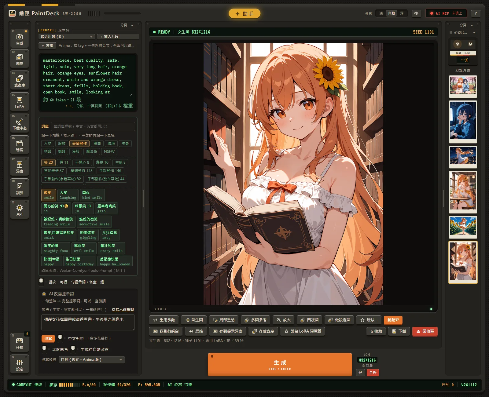

> **English:** A Windows/Linux front-end for local image/video generation on top of ComfyUI (Rust + Tauri 2, plain-JS web UI). Built-in model families: Anima, Qwen-Image 2.1, MOSS-Image, Krea 2, SDXL, plus MiniMax H3 video (local, RunPod or RunningHub) and imported ComfyUI workflows. Also includes a manga page maker, a director/long-video pipeline, a LoRA trainer, a frame-by-frame video inspector, a video editor, an MCP server for AI agents and an A1111-compatible API for SillyTavern. On Linux it also runs as a headless server (no desktop needed) that you use from a browser. The UI is Traditional Chinese with English and Simplified Chinese switches. Requires an NVIDIA GPU (AMD and Intel Arc GPUs: experimental, untested on real hardware; machines without a usable GPU can still install it and run ComfyUI on the CPU). Licensed under GPL-3.0.

## 目錄

- [功能一覽](#功能一覽)
- [生成頁](#生成頁) ・ [提示詞工具](#提示詞工具) ・ [生圖玩法](#生圖玩法) ・ [隨機頁](#隨機頁隨機產生器)
- [圖庫與提示詞庫](#圖庫與提示詞庫) ・ [資產庫](#資產庫) ・ [LoRA 庫](#lora-庫) ・ [下載中心](#下載中心)
- [生圖助手與 API 頁](#生圖助手與-api-頁)
- [影片：H3 短片與拍攝單](#影片h3-短片與拍攝單) ・ [長片](#長片一段一段接著拍) ・ [導演台](#導演台) ・ [拆幀台、剪輯台與混音台](#拆幀台剪輯台與混音台)
- [漫畫台與整本上色](#漫畫台與整本上色) ・ [訓練台](#訓練台煉-lora)
- [雲端、工作節點](#雲端工作節點) ・ [給 AI 操作與 SillyTavern](#給-ai-操作mcp與-sillytavern) ・ [模型與工作流](#模型與工作流)
- [介面：三種語言、深淺主題](#介面三種語言深淺主題) ・ [安裝精靈、更新、維護](#安裝精靈更新維護)
- [需要什麼](#需要什麼) ・ [安裝](#安裝一般使用者) ・ [升級](#從-anima-生圖站升級) ・ [解除安裝](#解除安裝) ・ [更新紀錄](#更新紀錄) ・ [從原始碼編譯](#從原始碼編譯)

## 功能一覽

| 功能 | 說明 |
|---|---|
| 生圖 | 文生圖、圖生圖、局部重繪、擴圖、多圖參考、放大、四視圖；構圖控制（LLLite／ControlNet、姿勢骨架、MOSS 色彩／深度）、高解析修復、版面框 |
| 生圖玩法 | 變體、修臉、修手（一張圖裡每張臉、每隻手都修）、差分（表情／動作）、一鍵去背、X/Y 對照表、塗鴉畫布 |
| 提示詞工具 | 「詞」詞庫抽屜（Danbooru 官方分類一萬五千多個 tag，或 WeiLin 四千多條）、中文／簡體找 tag、中英對照、英文 tag 後面的全形標點自動換半形、提示詞分段、批次、權重快捷鍵、LoRA 觸發詞標籤 |
| 隨機頁 | 照 15 段 57 欄的規則隨機組一整組提示詞（角色、服裝、場景都能固定，同種子結果固定），旁邊就是生成頁的提示詞、模型、LoRA、尺寸、取樣、附加和生成鈕；引擎是 ComfyUI 外掛 Comfyui-Anima-Wardrobe-V6 |
| AI 改寫、反推 | 一句中文想法改寫成完整提示詞（本機 llama.cpp 跑 9B／35B，或接 DeepSeek、GLM 等雲端大模型）；從圖片反推 Danbooru tag |
| 生圖助手 | 用中文說要什麼，助手自己寫提示詞、畫圖、看圖檢查、再修改 |
| 圖庫、提示詞庫、資產庫 | 每張圖都記得怎麼畫的；常用設定與片段存成提示詞庫；角色、場景、道具集中管理，角色卡工坊做多視圖設定圖 |
| LoRA 庫、下載中心 | 分類、收藏、觸發詞、預設強度、換預覽圖、列表檢視；從 C 站、魔搭、RunningHub 搜尋下載，放對資料夾 |
| 影片 | MiniMax H3 短片（文生／圖生／首尾幀／多素材參考…）、拍攝單、一段一段接著拍的長片（本機、RunPod、RunningHub），也能匯入自己的 ComfyUI 影片工作流 |
| 導演台 | 長劇情自動分段 → 每段首幀 → 影片 → 接成一部片，逐鏡審片 |
| 拆幀台、剪輯台、混音台 | 任何影片拆成一格一格看、修壞掉的幀再接回去；內建 [FableCut](resources/extras/fablecut/LICENSE) 剪輯台；混音台（要另外有 mixdesk 引擎） |
| 漫畫台 | 選版型或自己切格子、寫每格內容和台詞，MOSS-Image 一次畫出整頁；角色卡、照資產修角色（實驗性）；整本黑白漫畫上色 |
| 訓練台 | 把一包圖煉成 LoRA：本機、自己的訓練機、RunPod、C 站都能煉，打標、算步數、驗收都先幫你做好 |
| 給 AI 操作 | 內建 MCP 伺服器：Claude、Codex、Cursor 等 AI 可以直接叫它生圖、生影片、畫漫畫、剪片 |
| SillyTavern | 繪匣可以假裝成 Stable Diffusion WebUI（A1111），酒館聊天時直接叫繪匣畫插圖 |
| 雲端與多顯卡 | RunPod 雲端顯卡、自己的主機（SSH／網址）、RunningHub；多張顯卡或區網的 ComfyUI 一起分工 |
| 模型與工作流 | 外部模型資料夾原地使用、掃描整台電腦找已有的模型、拖檔或貼網址加裝；匯入自己的 ComfyUI 工作流當成一個模型選，或取代內建的某個功能 |
| 介面 | 繁體中文、簡體中文、英文；深色、淺色、跟系統；面板可以拖、可以收 |
| 安裝與維護 | 安裝精靈自動下載 ComfyUI、模型、llama.cpp、ffmpeg；App 內更新（Windows 公開版）；Linux 無頭版與桌面版；診斷紀錄、清理快取、匯出／匯入、恢復原廠 |

完整說明在程式內的使用手冊（`ui/manual.html`，程式裡按右上角「?」或「說明」打開）。

> 本頁的截圖都是在乾淨的測試環境拍的，畫面裡的圖是用 Anima Turbo 和 MOSS-Image 現畫的示範圖，LoRA 庫裡的 LoRA 是測試用的假檔案。

---

## 生成頁

最常用的一頁：左邊選模式、模型、寫提示詞，中間是看圖區，右邊是這次畫過的圖（幻燈片匣）。每個面板都能拖、能收成小標籤。

**模式**：文生圖、圖生圖、局部重繪（遮罩可以只重畫附近一塊）、擴圖、多圖參考（Qwen 2.1，`<image1>`、`<image2>` 指名）、放大（放大模型＋精修）、四視圖（角色設定稿一次改衣服、顏色，每個視角同步）。

**內建模型家族**（看模型檔頭自動判斷，不用自己選家族，預設參數也跟著換）：

| 家族 | 擅長 | 備註 |
|---|---|---|
| Anima | 動漫、Danbooru tag | Turbo 版 8 步、CFG 1；LLLite 構圖控制（線稿、塗鴉、深度、姿勢骨架） |
| Qwen-Image 2.1 | 寫實、照指令改圖、多圖參考、寫字 | Turbo 8 步；姿勢參考 |
| MOSS-Image | 排版、畫面裡寫字、漫畫整頁 | 版面框（指定東西放哪裡）、色彩／深度構圖控制、照指令改圖、去直條色帶、4B 省記憶體文字編碼器 |
| Krea 2 | 寫實照片感 | 文生圖、圖生圖、局部重繪、修細節、放大精修 |
| SDXL | Illustrious、NoobAI、Pony 這類 SDXL 模型 | 文生圖、圖生圖等常用模式 |
| 匯入的工作流 | 你自己在 ComfyUI 調好的任何東西 | 見[模型與工作流](#模型與工作流) |

設定開了卻不會生效（例如構圖控制用在不支援的家族），按下生成時會直接跳提示，不會默默畫一張沒照做的圖；LoRA 家族不合會列出被略過的是哪幾個。

### 提示詞工具

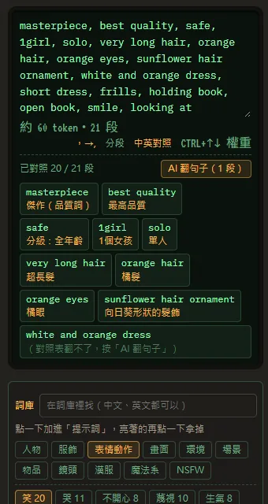

- **「詞」詞庫抽屜**：提示詞框右上按「詞」，打開分類詞庫。預設是 **Danbooru 分類**：照 Danbooru wiki 的 tag group 分 11 大類、92 小類，一萬五千多個 tag，每顆附中文和在 Danbooru 用過幾次，熱門的排前面、同一小類再分段；右上可以切成 **WeiLin**（人物、服飾、表情動作…11 大類 132 小類、約 4000 個詞，來自 [WeiLin-Comfyui-Tools-Prompt](https://github.com/weilin9999/WeiLin-Comfyui-Tools-Prompt)，MIT）。點一下加進最後點過的提示詞框（大框、分段小框、負面框都行），已經在框裡的會亮起來，再點一下拿掉；可以用中文或英文搜整個詞庫。
- **中文找 tag**：打中文就跳出對應的 Danbooru tag，簡體也找得到；2026-11 多了約 2 萬條翻譯，角色名逐條用 Danbooru wiki、Bangumi 校對過，會寫成「角色（作品）」。
- **中英對照**：提示詞框下面列出每個 tag 的中文，tag 查對照表，整句英文可以按「AI 翻句子」交給本機 AI 翻；正向、負面框都有。
- **全形標點自動換半形**：英文 tag 後面用中文輸入法打的「，、：（）」自動換成半形「, : ( )」，不用一直切輸入法；中文句子裡的不動，Ctrl+Z 換得回來。開關在提示詞框右下的「，→,」。
- **分段**：大框／小框切換，分成畫風、角色、姿勢、鏡頭幾格寫，大框同步。
- **權重**：游標放在 tag 上按 Ctrl+↑／↓ 調權重。
- **批次**：每行一句提示詞，各畫一組。
- **LoRA 觸發詞標籤**：掛了 LoRA 會在提示詞上面出現觸發詞小標籤，點了加進去、亮著的就是已經用上。
- **AI 改寫**：寫一句中文想法（例：「橘髮女孩在圖書館窗邊看書，午後陽光灑進來」），本機 llama.cpp 跑 Qwen 系列 9B／35B 改寫成完整提示詞，可以一直微調；可以開「深度思考」、「生成時自動改寫」，也能在 API 頁改成用雲端大模型。內建姿勢詞庫，看得懂口語的姿勢描述。
- **反推**：從圖片反推 Danbooru tag（WD EVA02，CPU 執行），附自動清理和中文對照。
- **讀圖片參數**：拖一張用繪匣、ComfyUI 或 A1111 畫的圖進來，讀出它的提示詞與參數；**拿去 ComfyUI 改**：把目前的設定存成 ComfyUI 工作流。
- **最近用過、插入片段**：提示詞庫的片段一鍵插入。

<br clear="right">

### 生圖玩法

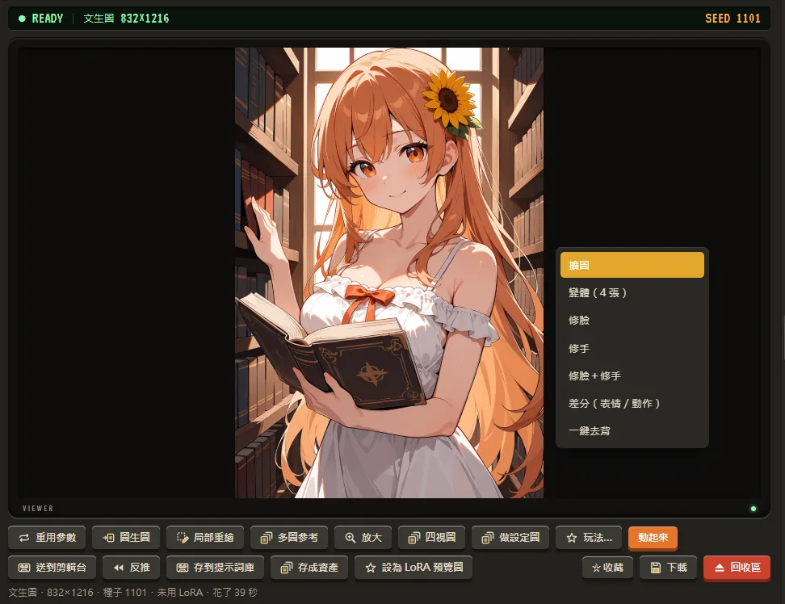

畫好的圖下面一排按鈕：重用參數、拿去圖生圖／局部重繪／多圖參考／放大／四視圖、做設定圖、送到剪輯台、反推、存到提示詞庫、存成資產、設為 LoRA 預覽圖、動起來（直接做成影片）。「玩法…」裡還有：

- **擴圖**、**變體**（同一張一次再畫 4 張）
- **修臉、修手、修臉＋修手**：SAM3 找出圖裡**每一張臉、每一隻手**（每種最多 8 個，大的先修）各自重畫一次，多人圖不會只修到一個
- **差分**：同一張圖改表情、改動作，其他地方不動
- **一鍵去背**

生成頁左欄另外有：

- **X/Y 對照表**：一次比較兩種設定（種子、步數、CFG、取樣器、LoRA 強度、提示詞替換…），畫完拼成一張表
- **塗鴉畫布**：自己畫草圖，Anima 當構圖控制，其他模型當圖生圖底圖

### 隨機頁：隨機產生器

左邊功能列的「隨機」是生成頁的分身，分三欄：左邊**隨機產生器**；中間是生成頁的提示詞（連同 AI 改寫）和 LoRA 卡匣，生成鈕和最新一張圖固定在底下；右邊是模型、尺寸、取樣（步數、CFG、張數、種子、整套設定）和附加（高解析修復、構圖控制、自動修臉、X/Y）。這些跟生成頁是同一組，在這頁改什麼、按生成都一樣。

- 隨機產生器的引擎是 ComfyUI 外掛 [Comfyui-Anima-Wardrobe-V6](https://github.com/lingdongbudong/Comfyui-Anima-Wardrobe-V6)（GPL-3.0，作者灵冻不冻）：照 15 段 57 欄的規則抽一整組提示詞，數量、頭髮、五官、身材、服裝、姿勢、鏡頭、場景、光影會互相搭配。繪匣不附它的檔案，第一次用在隨機頁按「安裝隨機產生器」從 GitHub 裝進本機 ComfyUI（固定版本），裝好重開 ComfyUI；自己用 ComfyUI Manager 裝過的不用再裝。
- 分級（全年齡～極端）、種子（填數字＝同樣的設定每次抽一樣）、tag 上限、服裝風格、胸部大小；按「全部隨機」先看，滿意再「套用到提示詞」（取代或接在後面）。勾「每次生成前重抽」，在隨機頁每按一次生成就換一組。
- **欄位**：每段可以關、調多少，每欄可以設「關／少／一般／多／必出」或固定成某個選項。**角色**：兩千四百多個角色縮圖，搜中文、英文或作品，點了固定出這個角色，可收藏。**服裝**：固定一套，或從勾選的分類每次挑一套（這兩個是外掛自己的設定，ComfyUI 工作流裡的 Wardrobe 節點也會跟著用）。**場景**：勾的場景放進勾選池，每次挑一組姿勢、構圖、光影。
- 外掛的文字是簡體，畫面上轉成繁體顯示（[opencc-js](https://github.com/nk2028/opencc-js)），送回外掛的還是原本的值。
- **AI 組成完整提示詞**：把提示詞框裡的 tag 交給 AI 改寫，照現在的模型寫成完整提示詞。AI 改寫的腦袋可以選本機、雲端或 API 頁的連線。

---

## 圖庫與提示詞庫

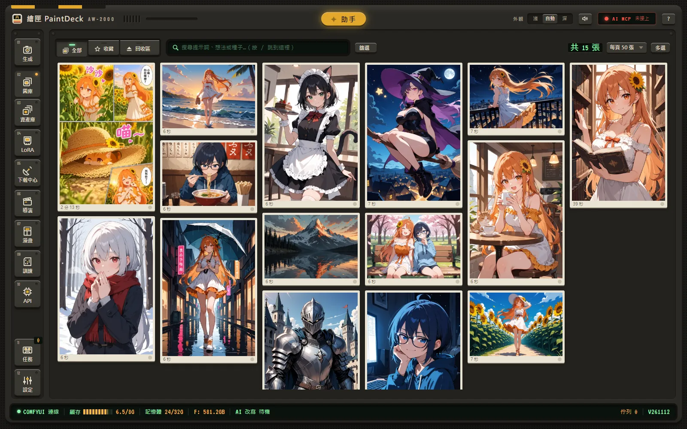

- **圖庫**：每張圖都記得怎麼畫的（模型、提示詞、LoRA、種子、花了幾秒），可以搜提示詞、想法或種子，依模式、模型、日期篩選；收藏、多選、回收區（刪了先進回收區，救得回來）。圖檔在硬碟上找不到時，會直接跟 ComfyUI 要回來。
- **提示詞庫**：好用的「整套設定」（模型＋參數＋提示詞）和「片段」存起來，分全部、整套設定、片段、最近用過、置頂。

## 資產庫

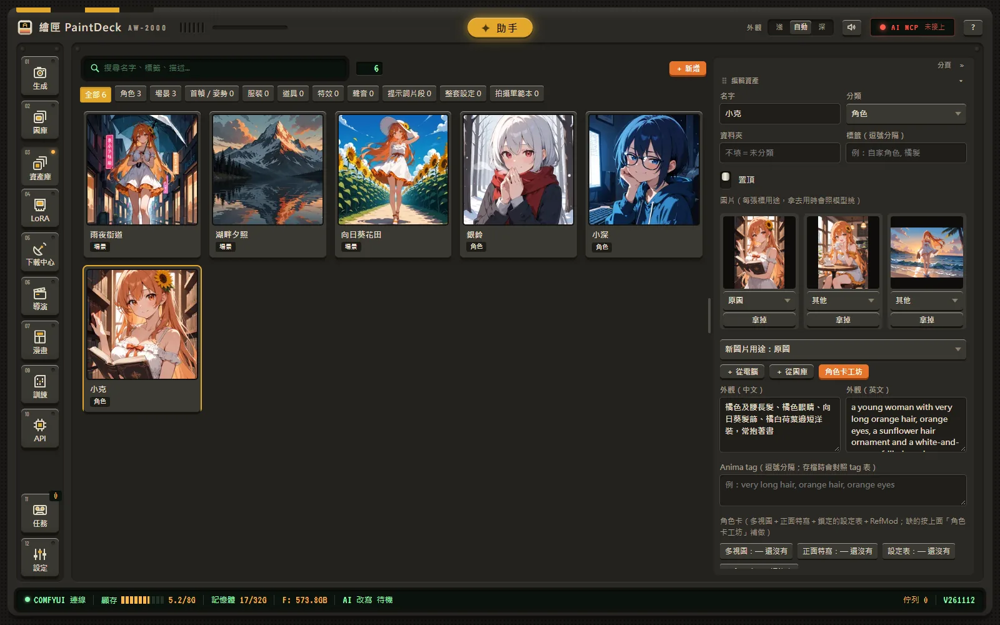

角色、場景、道具、首幀／姿勢、服裝、特效、聲音、提示詞片段、整套設定、拍攝單範本，**全站共用**：生成頁、拍攝單、長片、導演台、漫畫台都能從「資產」抽屜拿。

- 每張卡可以放好幾張圖、各標用途（原圖、正面特寫、多視圖、臉部特寫表、細節、姿勢、服裝…），拿去用時照模型挑對的圖。
- 中文、英文外觀和 Anima tag 各存一份，給不同模型用。
- **角色卡工坊**：從一張圖或一段文字做出全身轉身圖（多視圖）和臉部特寫表。
- **鎖定角色**：外觀變成固定段落，送出時自動接在提示詞最前面，AI 改寫碰不到；拍攝單、長片也照用。
- **綁 LoRA**：角色卡可以綁最多 4 個 LoRA，加進漫畫台時自動掛上。
- **RefMod 鎖臉**（實驗）：用社群外掛 ComfyUI-MiniMaxH3Mod 把角色做成 H3 影片用的臉部參考。

## LoRA 庫

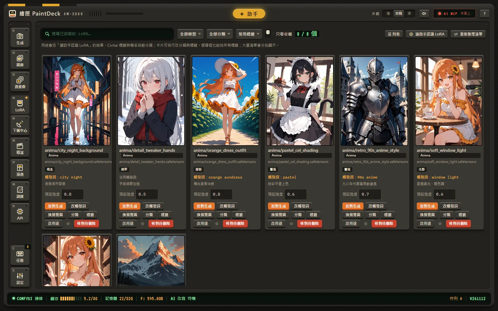

- 依模型家族、分類（畫風、角色、服裝、概念、姿勢、細節、光影…）、常用標籤篩選，搜尋名稱、觸發詞、備註。
- 每顆可以改觸發詞、預設強度、分類、標籤、收藏；「讓助手認識 LoRA」幫每顆寫用途說明，生圖助手會自己挑。
- 程式附說明的 LoRA（含 MOSS LoRA 合集每一顆的用途、觸發詞、強度範圍）會自動帶入；預載的 LoRA 內建 C 站封面縮圖。
- **換預覽圖**（2026-11）：選檔、拖放、Ctrl+V 貼上都行，也能在生成結果或圖庫按「設為 LoRA 預覽圖」；縮小另存一份，原圖不動，隨時「還原原本的預覽圖」。

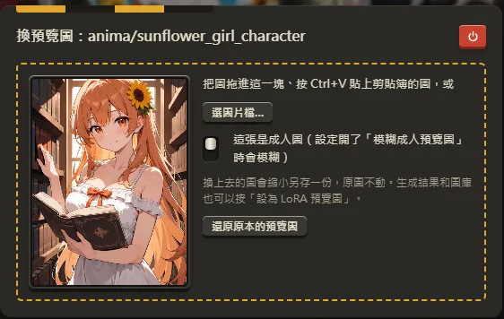

- **列表檢視**（2026-11）：LoRA 多的時候改成一列一顆，生成頁的挑選視窗也能切列表。

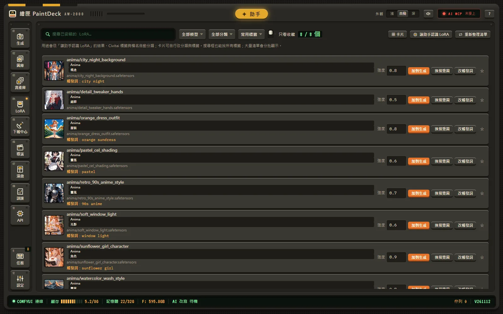

## 下載中心

從 **C 站（Civitai）**、**魔搭（ModelScope）**、**RunningHub** 搜尋 LoRA、主模型、VAE、工作流：

- 依繪匣的模型家族篩選（例如只看 Anima 的），標出「生圖站用不了的」、C 站付費（早鳥）的 LoRA，可以勾「不顯示付費」；成人內容預設不顯示。
- 卡片有樣張大圖、下載數、讚數、版本選擇；已經裝過的會標「已安裝」。
- 按下載就放進對的資料夾，觸發詞、預覽圖一起存好；有 SHA256 會核對。部分 C 站模型要先在設定填 Civitai API key。
- 魔搭支援分類標籤、底模篩選；RunningHub 的工作流可以直接匯入，或直接丟上 RunningHub 跑（花 RH 幣，會先確認）。

## 生圖助手與 API 頁

**生圖助手**（右上角「助手」）：用中文說要什麼，它自己寫提示詞、挑 LoRA、畫圖、看圖檢查哪裡不對、再修改，直到滿意。能做的事包括換模型、改圖、放大、去背、修臉修手、擴圖、做影片、畫多視圖、畫漫畫、查圖庫和資產庫。可以裝網路上的提示詞 skill（「外掛寫法」）讓它照特定寫法寫。腦袋可以是本機 9B／35B、雲端顯卡，或 API 頁接的大模型。

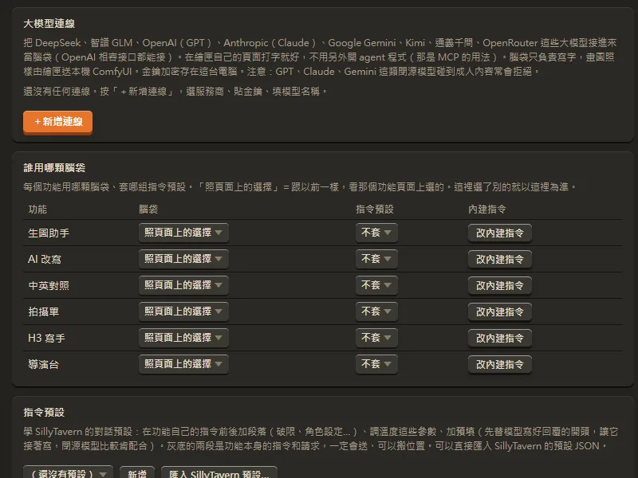

**API 頁**：

- **大模型連線**：DeepSeek、智譜 GLM、OpenAI（GPT）、Anthropic（Claude）、Google Gemini、Kimi、通義千問、OpenRouter，或任何 OpenAI 相容接口，可以存好幾組。金鑰加密存在這台電腦。
- **誰用哪顆腦袋**：生圖助手、AI 改寫、中英對照、拍攝單、H3 寫手、導演台各自選用哪一組、套哪個指令預設。
- **指令預設**：學 SillyTavern 的對話預設，在功能自己的指令前後加段落、調溫度、加預填；可以直接匯入 SillyTavern 的預設 JSON。

---

## 影片：H3 短片與拍攝單

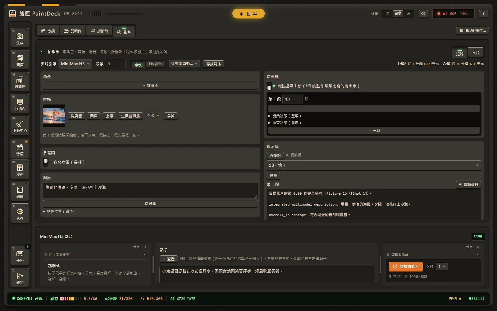

內建 **MiniMax H3**（有聲音的影片模型），1～15 秒，可以在**這台電腦**（8GB 顯卡用 w4a8 版、自動切塊省顯存）、**RunPod 雲端顯卡**或 **RunningHub** 拍。

- **玩法**：文生影片、圖生影片（首幀）、首尾幀、多素材參考（圖 ≤9、影片 ≤3、聲音 ≤3）、多關鍵幀、接續上一支、動作控制（骨架／深度／線稿）、換角色、特效改片、換畫風、動態桌布；附 39 個範本。
- **素材板**：把角色圖、場景、聲音放上去，AI 排出分鏡和台詞，照 H3 官方格式組提示詞。
- **拍攝單**：填角色、首幀、參考圖、場景、物件位置、每一段的時間軸（開始狀態、結束狀態、台詞），程式照影片引擎組好提示詞，送出前做 8 項檢查；「自動提早 1 秒」（H3 的動作常常比寫的晚出來）。可以存成範本。
- **聲音庫**：角色的專屬聲音存起來，每支片同一把聲音；台詞前可以寫聲音描述。
- **SelfLift 兩段取樣**、INT8 注意力加速、低顯存切塊、影片 LoRA 槽。
- 也能在「設定 → 影片模型」匯入自己的 ComfyUI 影片工作流（Wan、HunyuanVideo、LTX…），繪匣自動填提示詞、首格圖、種子、長度。

實測速度：本機 RTX 3070 8GB、864×480，每秒影片約算 70 秒；雲端 L40S 一段 10 秒約 4 分多鐘、每段約 US$0.08。

## 長片：一段一段接著拍

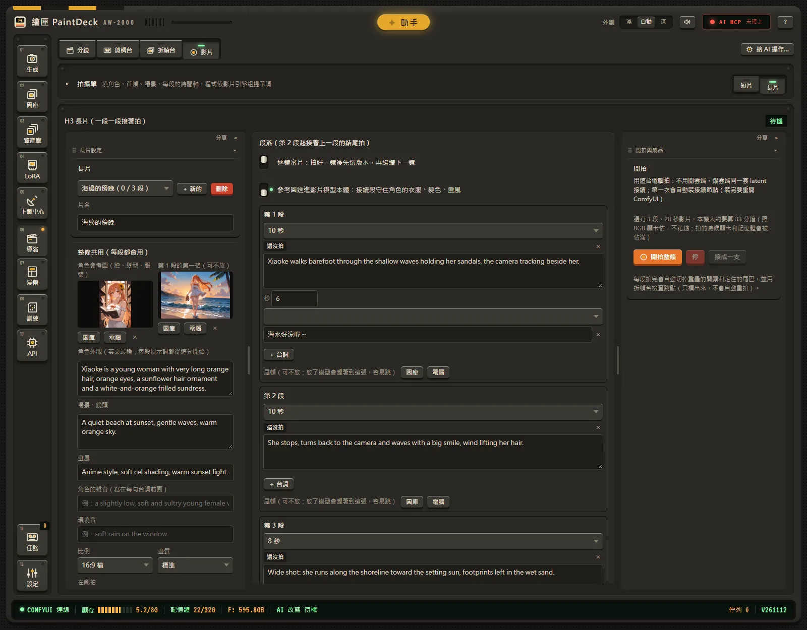

一條長片＝好幾段（每段 5～15 秒）。第 1 段從首幀開拍，第 2 段起直接吃上一段的影音 latent 接著拍（社群 Herrgotts H3 Infinite 節點，繪匣自己帶、第一次開拍時裝好），接縫自然。

- **在哪拍**：雲端顯卡（RunPod）、**這台電腦**（2026-11 起；不花錢，8GB 顯卡 10 秒一段約 10～12 分鐘）、RunningHub（8 秒一段約 80 RH 幣）。
- **參考圖進影片模型本體**（2026-11）：角色參考圖除了給文字編碼器，也直接送進影片模型每一步都看得到，接續段的衣服、髮色、畫風比較不會慢慢跑掉。
- 每段拍完自動切掉重疊的開頭、定住的尾巴，用拆幀台檢查硬剪接和跳點；**逐鏡審片**：每一段拍好幾個版本先選，再繼續下一段。
- 全部拍好用 ffmpeg 接成一支進圖庫。

## 導演台

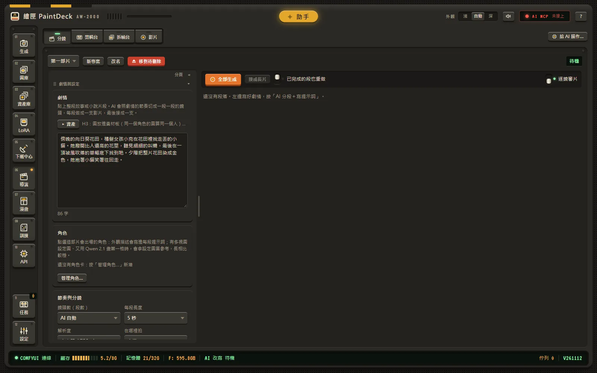

貼上整段故事或小說片段 → AI 照劇情的節奏切成一段一段的鏡頭、寫好每段提示詞 → 每段畫首幀（可以用角色設定卡讓長相一致）→ 每段做成影片 → 接成一支。可以逐鏡審片、只重做某幾段，也能把結果送到剪輯台再剪。

## 拆幀台、剪輯台與混音台

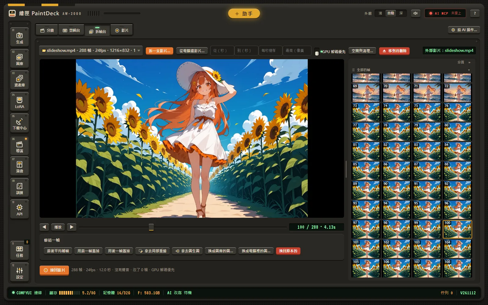

- **拆幀台**：任何影片（圖庫裡的或電腦裡的檔）拆成一格一格看，幀數沒有固定上限、只看硬碟空間；GPU 解碼優先。閃一下的壞幀可以用前後平均補、用前一幀／後一幀蓋掉、拿去局部重繪或圖生圖、換成別張圖，最後接回影片（聲音保留）。也能分析剪接點、接縫跳動、重複幀、鏡頭段落、音量，做逐格對照表和差異熱度圖。
- **剪輯台**：內建中文化的 [FableCut](resources/extras/fablecut/LICENSE) 瀏覽器剪輯台：多軌時間軸、標題、轉場、調色、混音器、匯出；「從圖庫加素材」直接把圖和影片放進來。

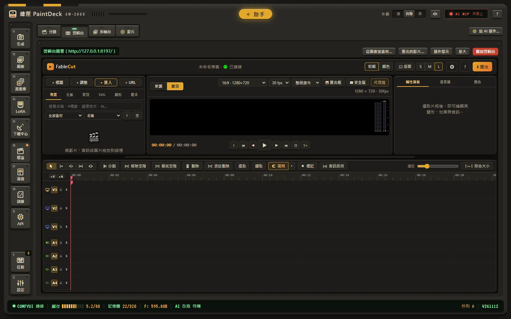

- **混音台**（導演頁的分頁，也能全螢幕）：專業混音軟體那樣的面板——時間軸上看每條音軌在動、調音台推桿（音量、聲像、靜音、獨奏、匯流排）、鋼琴捲軸改音符、樂器庫試聽、影片和原聲一起播。它是 **mixdesk**（Python 的譜檔作曲＋渲染工具，用 YAML 寫曲子）的畫面，面板和 mixdesk 改的是同一份譜檔。**mixdesk 引擎沒有附在繪匣裡、目前也還沒公開**，沒裝的話面板會說找不到 mixdesk；有的人到設定填 `mixdesk_dir`（預設找 `D:\AI\tools\mixdesk`，或資料資料夾旁邊的 `tools\mixdesk`）。

---

## 漫畫台與整本上色

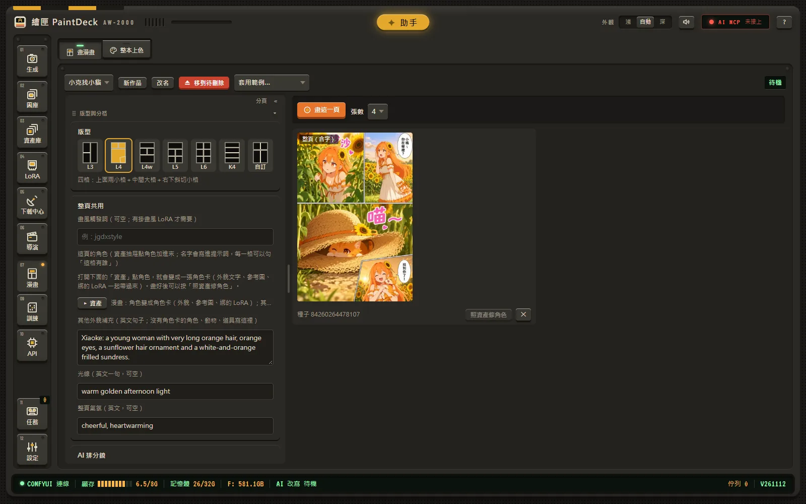


選版型、每格寫景別、畫面內容、台詞、對話框位置、狀聲詞 → **MOSS-Image 一次畫完整頁**，格子、台詞、狀聲詞都在同一張圖裡（右邊這頁就是這樣畫出來的，閱讀順序右上先）。

- **版型**：三格、兩種四格、五格、六格、四格漫畫（四格一樣大由上往下），或**自訂**：一刀一刀切格子（可以斜切）、加疊在上面的小格、人物破格；也能用說的排（「左邊一格大特寫貫穿整頁，右邊切三格」）讓 AI 拉格子。
- **AI 排分鏡**：貼一段劇情，本機 35B 拆成每一格並寫好內容。
- **角色卡**（2026-11，實驗性）：從資產庫點角色就做好一張卡（外觀句子、參考圖、綁的 LoRA），每一格勾「這格有誰」。
- **漫畫台 LoRA**：整頁共用的畫風 LoRA。
- **照資產修角色**（2026-11，**實驗性，效果不一定好**）：畫好後一鍵把每一格的角色長相修成跟資產庫一樣——切出每一格 → 找出每一顆頭 → 跟角色卡參考圖比長相、認出是誰（路人不動）→ 用 Qwen 2.1＋BFS 換頭 LoRA 只重畫頭部 → 表情掉了自動補回。要另外下載 BFS 換頭 LoRA（MIT），節點繪匣自己帶。
- **整本上色**：整本黑白漫畫（zip／cbz 或一堆圖，最多 400 頁）丟進來自動上色：彩頁（封面、彩色插圖）當配色參考，AI 先寫「角色配色表」、再照每一頁的位置寫上色指令，Qwen 2.1 一頁一頁上色；線條、字、網點和解析度都用原稿的，只拿 AI 的顏色。可以改某一頁的指令重上，最後整本打包下載。

<br clear="right">

## 訓練台（煉 LoRA）

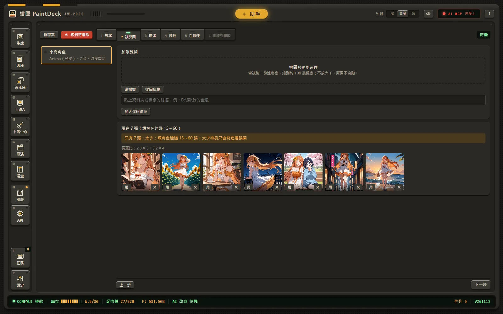

把一包圖煉成 LoRA，六步：專案 → 訓練圖 → 描述 → 參數 → 在哪煉 → 訓練與驗收。

- 支援 Anima、SDXL、Qwen 2.1、MOSS、Krea 2、H3（影片素材）。
- 訓練圖：拖進來、選檔、從圖庫挑、貼資料夾路徑；自動縮圖、找出太小或幾乎一樣的圖，張數不夠會提醒。
- 描述：自動打標（tag 用站內反推、句子用站內語言模型看圖寫），觸發詞自動留在最前面；角色每張都有的固定外觀會建議拿掉。
- 參數：照張數和種類（畫風、角色、概念）自動算步數，存幾版、樣張提示詞都先寫好。
- 在哪煉：**本機**（訓練器約 8GB，一鍵裝）、**自己的訓練機**、**RunPod**（先報價、煉完自動關機）、**C 站**（先試算要幾 Buzz）、魔搭（先打包資料集）。
- 驗收：每一版 × 每個強度同種子各畫一張排成對照表，挑好的那版自動寫好觸發詞、建議強度。

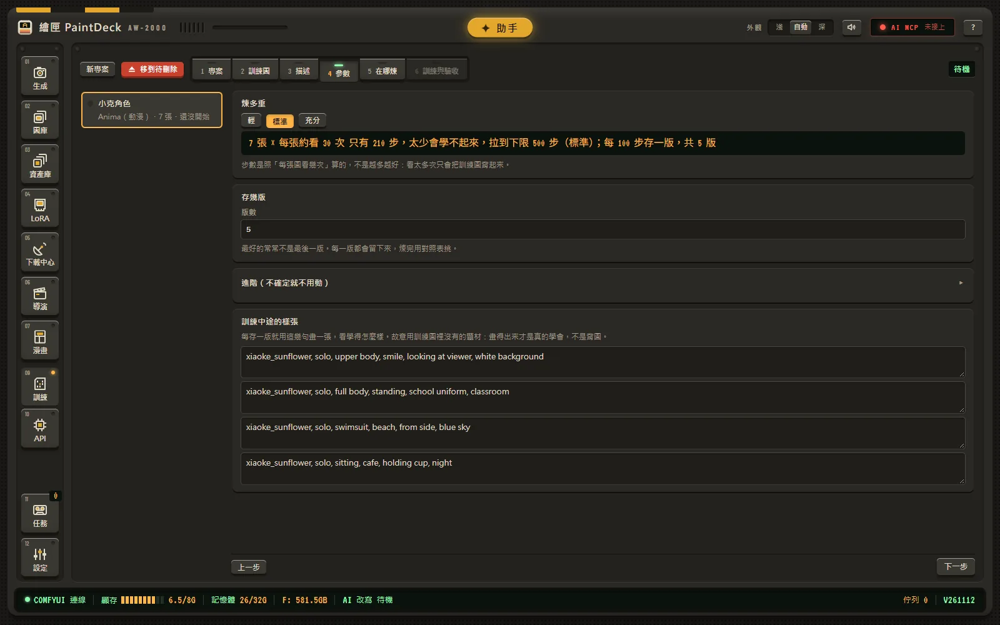

---

## 雲端、工作節點

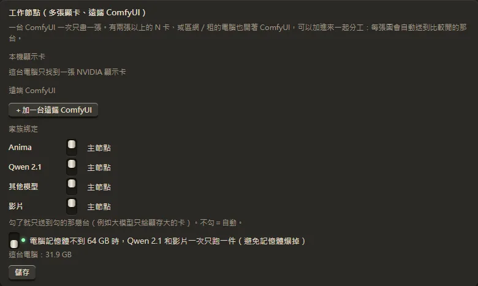

- **雲端顯卡**：RunPod 一鍵開機（先報價、要確認；推薦卡、庫存、價格自動抓），給生圖助手當腦袋、拍 H3 影片；也能接自己的主機（SSH 或網址）。關機要確認，提醒你別忘了關。
- **RunningHub**：不用開機器，把整份節點圖丟上去照秒扣 RH 幣（短片、長片都行）。
- **工作節點**：有兩張以上的 N 卡，或區網／租的電腦也開著 ComfyUI，可以一起分工，每張圖自動送到比較閒的那台；可以指定某個模型家族只給某台（例如大模型只給顯存大的卡）。記憶體不到 64GB 時，Qwen 2.1 和影片一次只跑一件，避免爆記憶體。

## 給 AI 操作（MCP）與 SillyTavern

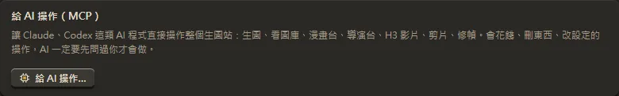

- **MCP**：讓 Claude Desktop、Claude Code、Codex CLI、Cursor 這類 AI 程式直接操作整個生圖站：生圖、看圖庫、漫畫台、導演台、H3 影片、生圖助手、提示詞庫、資產庫、剪片、修幀。設定頁按「給 AI 操作…」複製設定（也有 Codex 的 TOML 版）。會花錢、刪東西、改設定的操作，AI 一定要先問過你。沒裝 MCP 的 AI 也能照「開工前先讀」的說明直接打 HTTP API。

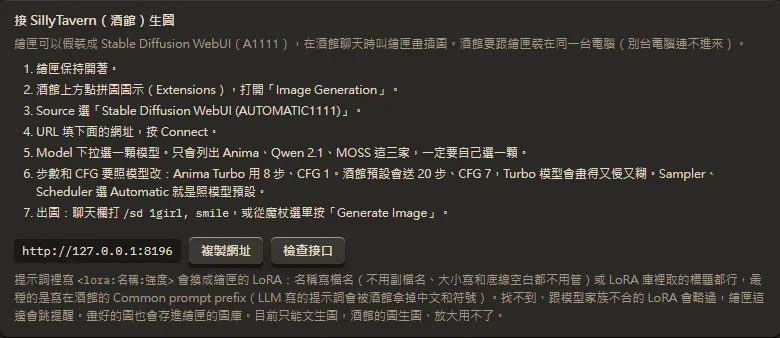

- **SillyTavern（酒館）**：繪匣提供 Stable Diffusion WebUI（A1111）相容接口（`/sdapi/v1/*`），酒館的 Image Generation 選 A1111、填網址就能叫繪匣畫插圖；提示詞裡的 `<lora:名稱:強度>` 會換成繪匣的 LoRA，名字對不上或家族不合會在繪匣跳提醒。

## 模型與工作流

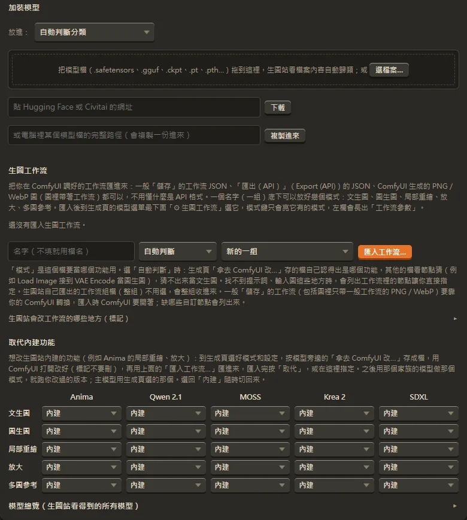

- **外部模型資料夾**：別的 ComfyUI、A1111／Forge 裡已經有的模型原地使用（寫成 ComfyUI 的 extra model paths，不搬檔、不重下）；「掃描這台電腦已有的模型」一次找齊。
- **加裝模型**：模型檔拖進來，看權重自動歸類；或貼 Hugging Face／Civitai 網址下載、貼電腦裡的路徑複製進來。
- **匯入生圖工作流**：一般「儲存」的工作流 JSON、「匯出（API）」的 JSON、ComfyUI 生成的 PNG／WebP 都可以；匯入後在生成頁模型選單「⚙ 生圖工作流」選它，左欄長出這份工作流的參數。缺什麼自訂節點會列出來。
- **取代內建功能**：例如想用自己調的 Anima 局部重繪流程，匯入後在表格裡指定「Anima × 局部重繪」用它，隨時切回內建。
- **影片模型**：同樣可以匯入 ComfyUI 影片工作流給「動起來」和導演台用。

## 介面：三種語言、深淺主題

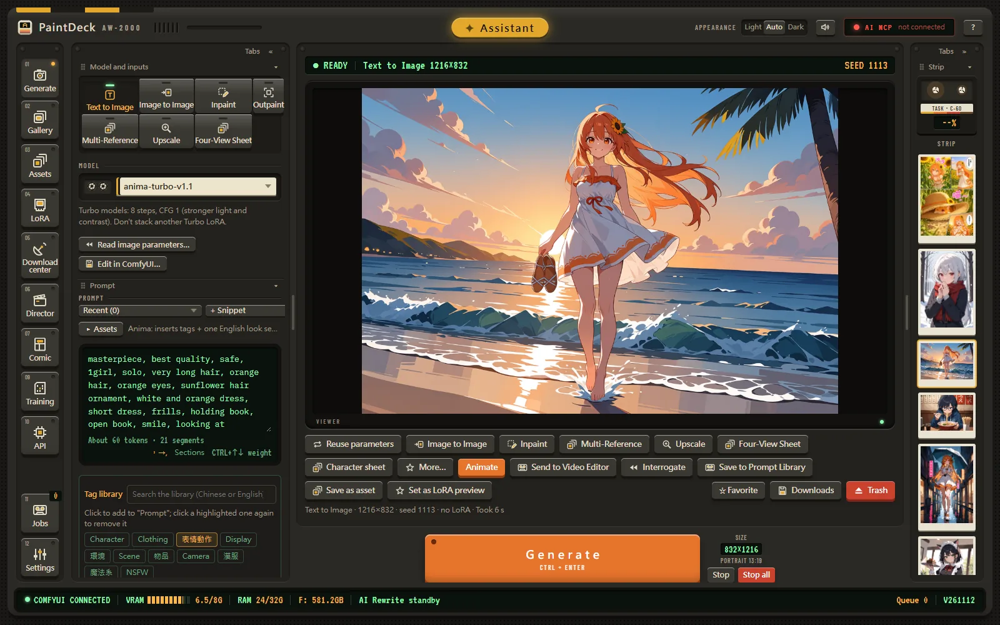

- **繁體中文**（原文）、**簡體中文**（OpenCC 自動轉）、**English**，設定頁第一項切換；教學手冊維持繁體中文。
- **外觀**：淺色、深色、跟系統（右上角）。

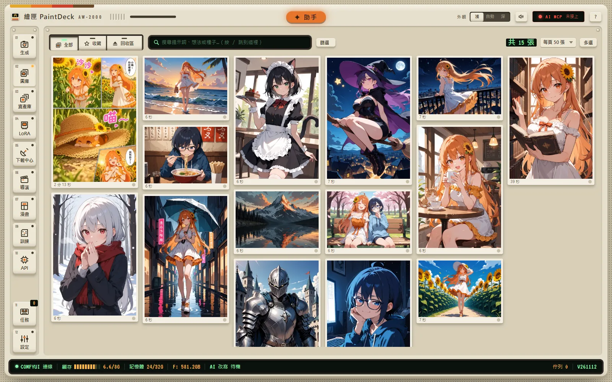

- 每塊面板都能抓標題列拖，放到看圖區旁邊會吸附，放到最邊邊會收成小標籤；版面自動記住，弄亂了一鍵恢復。
- 等圖時觀景窗裡有可以抓來玩的軟糖小熊。

## 安裝精靈、更新、維護

- **安裝精靈**：第一次打開時自動下載 ComfyUI、模型、llama.cpp、ffmpeg；選「基本版」或「完整版」，另有選配包（35B 改寫模型、H3 本機影片、MOSS LoRA 合集 80 顆、MOSS 省記憶體文字編碼器、影片選配…）。已經有 ComfyUI 可以直接沿用；能掃描整台電腦，別的 ComfyUI、A1111／Forge 裡已經有的模型原地使用。Civitai 金鑰可以在精靈裡填。
- **網路**：跟著系統代理、PAC、環境變數；Hugging Face 連不上自動改用 hf-mirror.com，再不行用繪匣放在魔搭的備份。設定頁可以測試每個下載來源。
- **ComfyUI 啟動方式**：加額外參數、改用自己開的 ComfyUI、改連接埠、用 CPU 跑；認得 A 卡的 ZLUDA 版、DirectML 版。舊版官方免安裝 ComfyUI 開站時自動升級到 0.43.0；附帶的節點、工作流程開站時自動換成新版。
- **App 內更新**（Windows 公開版）：「設定 → 程式更新」檢查新版，確認後才下載安裝。
- **維護**：診斷紀錄與錯誤回報（一鍵打包診斷資訊存進「下載」資料夾）、清理快取（縮圖、改寫、下載暫存…，不碰原圖和模型）、匯出／匯入設定、恢復原廠（搬到「待刪除」，可以救回）、預設負面提示詞。

---

## 需要什麼

| 項目 | 需要 |
|---|---|
| 系統 | Windows 10／11（64 位元）；或 x86_64 Linux（glibc 2.35 以上：Ubuntu 22.04、Debian 12 以後），有無頭版（純命令列）和桌面版（AppImage／deb）。Linux 版是新的，還沒有實機出圖測過 |
| 顯示卡 | NVIDIA，顯存 8GB 以上（開發時用 RTX 3070 8GB 實測；H3 影片本機也能跑） |
| A 卡（AMD） | **實驗性支援**：RX 5000 以後的獨顯、680M／780M／860M 以後的內顯，最新 AMD 驅動。精靈會改下載官方 AMD 版 ComfyUI 和 llama.cpp Vulkan 版，官方版沒附的架構再換成 AMD 的 ROCm 10 PyTorch（RX 6000 用 gfx103X 專用版）；也認得 ZLUDA 版、DirectML 版 ComfyUI。還沒有 A 卡實測過 |
| Intel 顯示卡 | **實驗性支援**：Arc 獨顯、Core Ultra 的 Arc 內顯（改下載官方 Intel 版 ComfyUI）；UHD、Iris Xe 不支援。還沒實測過 |
| 沒有能用的顯示卡 | 照樣能裝，ComfyUI 用 CPU 跑（很慢）；可以接雲端顯卡或 RunningHub |
| 記憶體 | 16GB 起跳，做影片建議 32GB |
| 硬碟 | 基本版約 20GB；完整版約 90GB |

## 安裝（一般使用者）

到 [Releases](https://github.com/sressky12-ux/PaintDeck/releases) 下載安裝檔 `PaintDeck_<版本>_x64-setup.exe` 雙擊安裝。安裝檔沒有付費簽章，Windows 可能跳出「Windows 已保護您的電腦」：按「其他資訊」→「仍要執行」。第一次打開會進安裝精靈，照畫面選資料放哪裡、要下載哪些模型就好。

### Linux

- **無頭版（純命令列，省記憶體）**：下載 `paintdeck-server-<版本>-linux-x64.tar.gz`，解開執行 `./anima-server`，用瀏覽器操作。
  不用裝桌面環境，也不連 GTK／WebKit，記憶體都留給 ComfyUI 和模型。第一次會進網頁版安裝精靈：可攜式 Python 3.12、ComfyUI 原始碼、
  PyTorch（N 卡 CUDA、A 卡 ROCm、Intel XPU、沒有顯示卡用 CPU）、模型都由精靈下載到你選的資料夾，不用 root。
  - 別台電腦用：`ssh -N -L 8190:127.0.0.1:8190 使用者@伺服器`，再開 `http://127.0.0.1:8190/`（最安全）
  - 區網直接連：`./anima-server --host 0.0.0.0 --allow-host 192.168.1.20`（沒有密碼，只在信任的網路用）
  - 開機自動開：壓縮檔裡的 `paintdeck-server.service`（systemd 使用者服務）；其他參數看 `./anima-server --help`
- **桌面版**：`PaintDeck_<版本>_amd64.AppImage`（`chmod +x` 後直接執行）或 `.deb`（`sudo apt install ./PaintDeck_<版本>_amd64.deb`），跟 Windows 版一樣有視窗和系統匣。
- 兩種都要：N 卡驅動 570 以上（`nvidia-smi` 能用）；影音工作台要系統的 ffmpeg（`sudo apt install ffmpeg`）。桌面版的「選資料夾」要 zenity 或 kdialog。
- Linux 版沒有 App 內更新：到 Releases 下載新版換掉；金鑰沒有 Windows 的 DPAPI 加密，是明文存在資料資料夾的 `data/`（只有自己能讀）。

完整版有幾個模型放在 Civitai，要先在「設定」填 Civitai API key 才下載得到（手冊第 01 章有申請步驟）。

## 從 Anima 生圖站升級

1. 先從系統匣右鍵「結束」，關掉舊版。
2. 到 Windows 設定解除安裝「Anima 生圖站」，**不要勾「刪除應用程式資料」**。
3. 安裝「繪匣 PaintDeck」。按「瀏覽」選資料夾後，安裝程式會再加一層 `繪匣 PaintDeck`。
4. 第一次開啟會沿用原本的設定、資料位置與圖庫；有用 MCP 的，請到「設定 → 給 AI 操作」重新複製設定。

改名後 Windows 會把新舊版當成兩套程式，兩套共用設定與連接埠，不能同時開。若裝在同一個資料夾，兩筆解除安裝紀錄可能指向同一個 `uninstall.exe`；安裝新版後再解除安裝舊版，可能把新版一起移除。勾刪除應用程式資料會清掉程式記住的資料位置，必須重跑精靈指回原資料夾；圖庫檔案仍在原資料資料夾。解除安裝時如果跳出「要不要連模型、ComfyUI 和所有資料一起刪掉？」，升級時一定要按「只移除程式，資料留著」。

## 解除安裝

到 Windows 設定解除安裝「繪匣 PaintDeck」，按下解除安裝後會跳出確認視窗，列出每個資料夾跟大小：

- **全部刪除**：永久刪除（不進資源回收筒）ComfyUI 整個資料夾（模型、LoRA、工作流、自訂節點、AI 改寫模型）、繪匣的資料、安裝暫存和程式設定，以及刪完變空的外層資料夾（例如 `AnimaStudio`）。基本版模型大約 42GB，選這個才會真的空出空間。
  - 生成的圖片（`ComfyUI\output`）預設留著；勾「連生成的圖片一起刪」才會刪。
  - junction 只拆連結，指到的檔案不刪；自己加的外部模型資料夾不動。
  - 安裝時選的是自己原本的 ComfyUI，也會整個刪掉。
- **只移除程式，資料留著**（預設）：只移除程式，模型和資料都留在原位，之後重裝可以直接沿用。

已經用舊版移除、模型還留在硬碟上的話：模型和 ComfyUI 預設放在空間最大那顆硬碟的 `X:\AnimaStudio\`，確認裡面是 `anima_data` 和 `ComfyUI_windows_portable` 後整個刪掉就好。

現有 `26.10.24` 與更早版本都沒有 App 內更新功能；第一個支援更新的版本仍須手動安裝一次。之後公開版可在「設定 → 程式更新」檢查新版，確認後才下載安裝。第一個支援本體更新的公開版是 26.1024.1。

## 更新紀錄

版號是「年.月日.當天第幾包」（例如 `26.1117.4`）。安裝檔和每一版的完整說明在 [Releases](https://github.com/sressky12-ux/PaintDeck/releases)。

| 版本 | 日期 | 內容 |
|---|---|---|
| **26.1123.3** | 2026-11-23 | 修好「掃描這台電腦已有的模型」把 models 底下的子資料夾（例如 `diffusion_models\Anima`、`Qwen`、`MOSS`）重複登記，模型選單同一個模型出現兩份（`Anima\x` 和 `x`）。已經重複的人更新後重開一次繪匣就好，開站會自動拿掉。 |
| 26.1123.2 | 2026-11-23 | 新增「畫廊」頁（頂列「全部功能」裡的 13）：直接搜 Danbooru、Gelbooru、Safebooru 的參考圖，圖源是 ComfyUI 外掛 ComfyUI-Aaalice-Nodes（MIT，作者 Aaalice233），第一次用按「安裝圖源外掛」。點圖看大圖和分好類的 tag，可以送到圖生圖、加進多圖參考，或一鍵複用原圖的 tag（照 Anima 的順序排、畫師加 @、浮水印這類雜 tag 拿掉）。搜尋框打幾個字母就跳推薦（tag 補完附中文、類別、張數，搜過和收藏的也列出來），中文可以直接打（「初音雙馬尾」自動換成 tag），搜尋列下面有「搜過」「常用」膠囊、☆ 收藏搜尋。Gelbooru 要填自己的帳號。提示詞框打中文找 tag 多認得 WeiLin 詞庫的常用詞（睡覺→sleeping、熱褲→short_shorts）。反推視窗可以自己換圖（選檔、拖放、貼上）。淺色主題的詞庫抽屜、衣姿抽屜、拍攝單等看不清楚的字調深。 |
| 26.1123.1 | 2026-11-23 | 生成頁改成左右兩欄：左欄放模型和這個模式要的東西（圖生圖的輸入圖、反推提示詞、重繪幅度，局部重繪、擴圖、多圖參考、放大各自的設定，切模式跟著換）；右欄上面多「這張圖」，重用參數、圖生圖、放大、反推、收藏、下載、存成資產、動起來這些成品動作全部攤開，一直看得到。按 Ctrl＋K（或模式列「⌕ 找功能」）打字找功能，Enter 直接跳過去。提示詞卡多「反推」鍵。 |
| 26.1122.5 | 2026-11-23 | 版面改成「中央舞台」：頂列放常用頁（Alt＋數字換頁，其他頁在「全部功能」），生成頁中間是大預覽、底下是提示詞卡；面板位置固定，只能收起、展開；詞庫從提示詞卡上方彈出；LoRA 卡匣改兩行，挑 LoRA 可以一次勾好幾個。新的圖片模型 **MiniMax H3 Image**：文生圖、最多 16 張參考圖改圖、4～20 百萬畫素，有 8GB 顯卡建議設定（安裝精靈兩個選配包，下載中心、LoRA 頁也認得）。新增「衣姿」（posewear，MIT）：生成頁「衣」抽屜把服裝／姿勢拖進提示詞、構圖控制、多圖參考；整頁會跟 posewear 官網同步（對不上時退回內建版），試穿工作台「➜ 交給繪匣」把整套原圖和提示詞送進多圖參考。訓練台接上 KohakuMoss（MOSS 本機 8GB 可煉）。 |
| 26.1121.1 | 2026-11-21 | 訓練台：本機顯卡比建議少 2GB 以內（例如 8GB 煉 Anima）也可以煉，會先警告、確認後才開始（8GB 實測 1550 步約 4～5 小時）；「安裝訓練器」在 ComfyUI 免安裝版的 Python 上跳「No module named manager」修好；PyTorch 看不到 NVIDIA 顯卡時算安裝失敗，提示先更新驅動；資產庫轉身圖改成左邊正臉＋側臉特寫、右邊正／側／背三個全身 |
| 26.1120.1 | 2026-11-20 | 安裝精靈第 3 步「掃描這台電腦已有的模型」可以選「**只掃指定的資料夾**」（不用再等整台電腦掃完，資料夾清單會記住；`/api/models/scan` 也收 `roots`）；H3 提示詞健檢多 6 條（格式、官方欄位、台詞、提到卻沒放的素材、聲音、放了卻沒提到的素材），每條標依據，H3 頁自己寫的提示詞也會檢查；導演台、長片的版本可以「並排比較」（兩版同步播放）；安裝精靈第 03 步列出安裝計畫（會裝什麼、多大、硬碟夠不夠） |
| 26.1117.4 | 2026-11-17 | 左邊新的「**隨機**」頁：隨機產生器（ComfyUI 外掛 Comfyui-Anima-Wardrobe-V6，GPL-3.0，第一次用按「安裝隨機產生器」）照規則抽整組提示詞，角色、服裝、場景可固定，旁邊直接是生成頁的提示詞、模型、LoRA、尺寸、取樣、附加和生成鈕；「AI 組成完整提示詞」、AI 改寫可選本機／雲端／API 腦袋；導演頁「**混音台**」分頁（要另外有 mixdesk 引擎）；生成頁提示詞框多一個「詞」詞庫抽屜（預設 Danbooru 官方分類一萬五千多個 tag 附使用次數，也可切 WeiLin-Comfyui-Tools-Prompt，MIT）；中文找 tag 多了約 2 萬條翻譯（角色名逐條用 Danbooru wiki、Bangumi 校對），簡體也搜得到；英文 tag 後面打的「，、：（）」自動換半形（提示詞框右下「，→,」開關）；LoRA 庫可以換預覽圖（選檔／拖放／貼上／從生成結果與圖庫設定，可還原）、列表檢視；漫畫台角色卡、漫畫台 LoRA、照資產修角色（比對長相挑頭、BFS 換頭、表情掉了補回；**實驗性，效果不一定好**）；修臉修手一次修全部的臉和手；本機拍長片、長片參考圖進影片模型本體；開了卻不會生效的設定會跳提示；主頁圖生圖「Invalid image file」修正 |
| 26.1112.1 | 2026-11-12 | 生圖助手（本機腦袋）拿掉多餘的內容過濾，LoRA 觸發詞改在最後才加上、不會再被吃掉 |
| 26.1111.1 | 2026-11-11 | 新的「訓練」頁：自己煉 LoRA（本機、自己的訓練機、RunPod、C 站；魔搭先做到打包資料集）；生成頁提示詞分段；觸發詞標籤重寫；酒館 LoRA 比對放寬並新增 `/sdapi/v1/loras`；LoRA 封面縮圖內建；全專案審查的修正（下載中心裝的影片模型選不到、漫畫台劇情欄不存檔等） |
| 26.1108.1 | 2026-11-08 | LoRA 庫裡預載的 LoRA 自動抓 C 站封面當預覽圖（抓不到換魔搭、Hugging Face），沒有封面的卡片寫 LoRA 名稱；Linux deb 套件名改成 PaintDeck（dpkg 不收中文名） |
| 26.1107.1 | 2026-11-07 | **Linux 版**：無頭版（純命令列，網頁精靈）和桌面版 AppImage／deb；GitHub Actions 在 Ubuntu 22.04 編譯與冒煙測試 |
| 26.1106.1 | 2026-11-06 | Krea 2、SDXL（Illustrious／NoobAI／Pony）變成內建模型家族；下載中心標出 C 站付費（早鳥）LoRA，可勾「不顯示付費」；A 卡 RX 6000 不走 hipBLASLt |
| 26.1105.2～.5 | 2026-11-05 | A 卡：開站自動檢查、補裝這張卡架構的 PyTorch（網路失敗下次再試），RX 6000 改裝 gfx103X 專用 PyTorch，精靈選錯的架構會改回；comfyui.log 開頭寫 A 卡狀態；白話錯誤；診斷包直接存進「下載」資料夾並收 ComfyUI 開機 log；AI 改寫系統提示修正 |
| 26.1102.2 | 2026-11-02 | 設定頁「接 SillyTavern（酒館）生圖」教學（複製網址、檢查接口）；MiniMax H3 影片模型不再被誤判成 Anima |
| 26.1102.1 | 2026-11-02 | 左邊「API」頁（多組大模型連線、誰用哪顆腦袋、SillyTavern 式指令預設與匯入）；生圖助手可以外接 DeepSeek、GLM 等 API；提示詞框中英對照（正向＋負面）；SD WebUI（A1111）相容 API；**多節點生成**（多張 N 卡、區網／租的 ComfyUI 一起分工） |
| 26.1031.4 | 2026-10-31 | ComfyUI 升級到 0.43.0（安裝、修復、開站時自動升級官方免安裝版）；MOSS 新增色彩／深度構圖控制、去直條色帶、4B 省記憶體文字編碼器、照指令改圖；選配包「MOSS LoRA 合集」（80 顆，每顆有中文備註）；**內建影片 LTX-2.3 換成 MiniMax H3**；**下載中心**（C 站／魔搭／RunningHub）；漫畫台**整本上色**；AI 改寫、整本上色可以切 35B／9B；讀圖片參數；開站自動把附帶的節點、工作流程換成新版；缺 LoRA 一鍵下載認得別的資料夾裡的同一顆 |
| 26.1029.1 | 2026-10-29 | 外掛寫法（裝網路上的提示詞 skill 給站內 AI 用）；AI 改寫與姿勢詞庫優化、思考上限與鬼打牆偵測；助手的生圖設定可直接編輯；Anima 姿勢骨架／深度 LLLite；Civitai 搜尋預設全部基底；35B 選配包 |
| 26.1028.2 | 2026-10-28 | 外部模型資料夾的模型進得了模型選單；看圖區不再被長說明撐出去；不再連到用別的 `--base-directory` 開的 ComfyUI（26.1028.1） |
| 26.1027.2 | 2026-10-27 | 生圖助手、影片與 LoRA 功能更新 |
| 26.1025.3 | 2026-10-25 | 智慧安裝精靈（辨識並沿用舊資料）；圖庫找不到檔案時跟 ComfyUI 要回來；漫畫台 AI 排分鏡、自訂版面；MCP 入口；拆幀 CUDA 解碼優先與空間清理；影片 LoRA 槽、導演台影片提示詞改時間軸寫法（26.1025.1～.2） |
| 26.1024.1 | 2026-10-24 | App 內更新；安裝精靈可填 Civitai 金鑰；快取清理；改寫模型多來源搜尋 |
| 26.10.24 | 2026-10-24 | **首次公開**（舊名 Anima 生圖站） |

## 從原始碼編譯

需要：

- [Rust](https://rustup.rs/)（stable）
- Tauri CLI：`cargo install tauri-cli --version "^2" --locked`
- WebView2（Windows 10／11 大多內建）
- Node.js 只有跑前端語法檢查時要；Python 只有跑 `tools\` 裡的維護腳本時要

```powershell
# 1. 下載不放進版控的兩個執行檔（onnxruntime.dll、7zr.exe），會比對 SHA-256
powershell -ExecutionPolicy Bypass -File tools\fetch_vendor.ps1

# 2. 測試（不需要模型或 ComfyUI）
cd src-tauri
cargo test
cargo clippy --all-targets -- -D warnings

# 3. 打包成安裝檔（輸出在 src-tauri\target\release\bundle\nsis\）
cargo tauri build
```

### 開發時只跑網頁伺服器

`anima-server` 不開視窗、只跑內建網頁伺服器，改前端時重新整理瀏覽器就看得到：

```powershell
cd src-tauri
$env:ANIMA_ROOT = "$env:TEMP\anima_dev\root"   # 資料根目錄（資料庫、設定、待刪除）
$env:ANIMA_WEB  = "..\ui"                      # 網頁檔
$env:ANIMA_RES  = "..\resources"               # 程式附帶的資料
$env:COMFY_ROOT = "D:\ComfyUI_windows_portable\ComfyUI"  # 選填，預設是資料根目錄旁邊的 ComfyUI_windows_portable\ComfyUI
$env:COMFY_URL  = "http://127.0.0.1:8188"      # 選填
$env:ANIMA_PORT = "8191"                       # 選填，預設 8191（正式版用 8190）
cargo run --bin anima-server
```

然後用瀏覽器開 `http://127.0.0.1:8191`。伺服器只聽 127.0.0.1，也只接受本機頁面的請求。

### Linux

```bash
# 系統套件（Ubuntu 22.04 以後；只編無頭版的話只要 libssl-dev、pkg-config）
sudo apt install libwebkit2gtk-4.1-dev libgtk-3-dev libayatana-appindicator3-dev librsvg2-dev libssl-dev libxdo-dev patchelf
bash tools/fetch_vendor.sh                      # libonnxruntime.so，會比對 SHA-256
cd src-tauri
cargo test
cargo tauri build --bundles deb,appimage        # 桌面版
cd .. && bash tools/linux_headless.sh           # 無頭版 tar.gz（cargo build --no-default-features，不連 GTK／WebKit）
```

`.github/workflows/linux.yml` 在 Ubuntu 22.04 上跑同樣的步驟，再開起來做冒煙測試。

## 專案結構

| 位置 | 內容 |
|---|---|
| `src-tauri/src/main.rs` | 桌面版：視窗、系統匣、第一次啟動的安裝精靈 |
| `src-tauri/src/server/` | 內建網頁伺服器（axum）：所有 `/api/*` 路由，`mod.rs` 的 `router()` 是總表 |
| `src-tauri/src/graphs.rs`、`families.rs` | 把網頁送來的參數組成 ComfyUI 節點圖（各模式、各模型家族）；看檔頭判斷模型家族 |
| `src-tauri/src/comfy.rs`、`nodes.rs` | 跟 ComfyUI 溝通：送任務、收進度與預覽、斷線重連；多個工作節點分工 |
| `src-tauri/src/pe.rs`、`tags.rs`、`tagger.rs` | AI 改寫（管理 llama-server、組請求、修補輸出）；tag 字典與中文對照；反推 |
| `src-tauri/src/agent.rs`、`director.rs`、`comic.rs`、`studio.rs`、`train.rs` | 生圖助手、導演台、漫畫台、影音工作台、訓練台 |
| `src-tauri/src/h3.rs`、`h3chain.rs`、`shotsheet.rs` | H3 短片、長片、拍攝單 |
| `src-tauri/src/setup.rs` | 安裝精靈：下載、解壓、檢查、同步附帶節點 |
| `src-tauri/src/model_dirs.rs`、`image_wf.rs`、`video_wf.rs` | 外部模型資料夾與整台電腦的模型掃描；匯入的 ComfyUI 生圖／影片工作流 |
| `src-tauri/src/db.rs` | SQLite（圖庫、任務、提示詞庫、LoRA 說明） |
| `src-tauri/tests/` | 整合測試：`api_routes.rs` 真的開伺服器打 API；`golden_*.rs` 跟舊版 Python 實作的輸出逐項比對 |
| `ui/` | 網頁介面：原生 ES module，不用打包工具；`js/main.js` 是進入點，`i18n/en.json` 是英文字典 |
| `resources/` | 程式附帶的資料：姿勢彙整、Danbooru tag 與詞庫、提示詞範本、ComfyUI 節點與工作流程、模型下載清單、剪輯台 |
| `tools/` | 維護腳本：英文字典（`i18n_extract.py`）、下載附帶執行檔（`fetch_vendor.ps1`）、姿勢圖渲染（`pose3d/`）、詞庫轉換（`weilin_tags.mjs`） |
| `docs/screenshots/` | 本頁的截圖 |

介面文字改了以後，跑 `python -I tools/i18n_extract.py extract` 找出還沒翻的句子，翻好存成 `tools/i18n/done_NN.json`，再跑 `build` 產生 `ui/i18n/en.json`。

## 內容與模型

- 這是一套本機工具，能畫什麼由你下載的模型決定，其中包括成人內容：完整版清單有成人向 LoRA，H3 影片台有「成人」分組的範本，只給 18 歲以上的成年人使用。請遵守你所在地的法律，以及每個模型、LoRA 各自的授權條款（下載頁面上寫的那份）。
- 生圖助手不會自己挑「調整年齡」類的 LoRA（`agent.rs` 的 `agent_may_pick`）。
- 模型不包含在這個專案裡，安裝精靈從 Hugging Face、Civitai 等原始出處下載；下載清單在 `resources/share/models_*.json`。

## 授權

GPL-3.0，見 [LICENSE](LICENSE)。專案裡附帶的第三方程式碼、字型和資料（FableCut 剪輯台、WeiLin 詞庫等）各有授權，列在 [THIRD_PARTY_NOTICES.md](THIRD_PARTY_NOTICES.md)。
